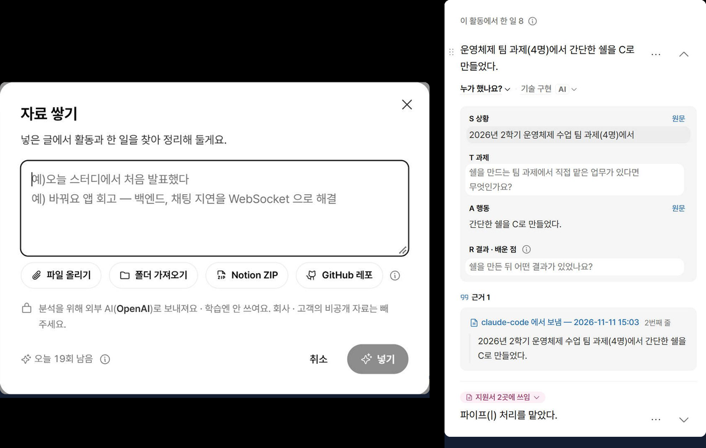
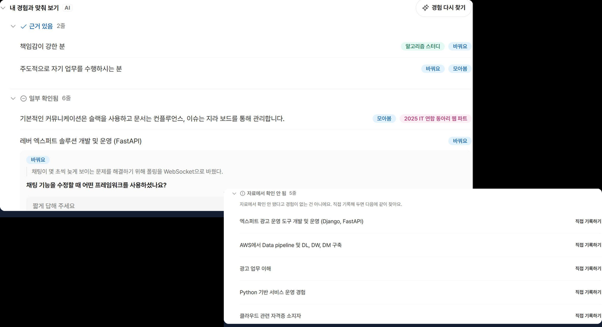
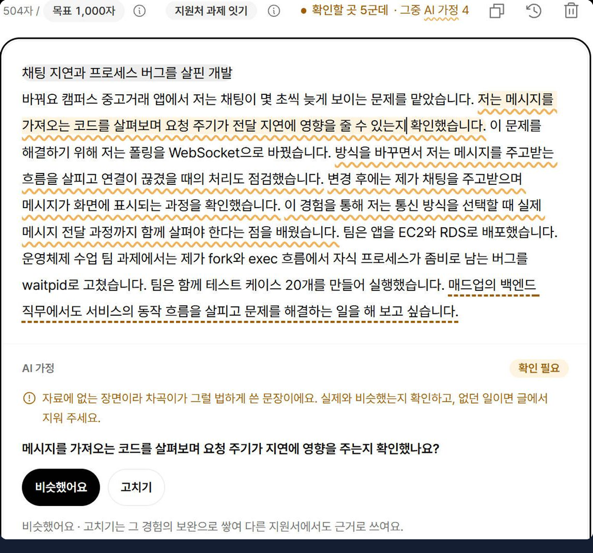
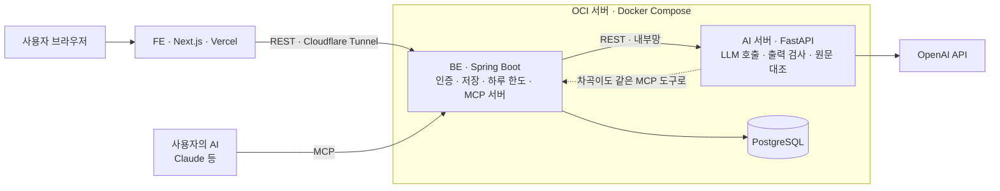

# 차곡 — 흩어진 기록은 차곡차곡 정리하고, 지원서엔 딱 맞게 꺼내 쓰는 AI 동료

2026 AI 우왕톤 12팀 「내가 우왕이 될 상인가」

**서비스: https://app-woowang.miroda.live** — 심사용 테스트 계정은 제출 폼에 적었다(Public 레포라 여기엔 적지 않는다).

<!-- 시연 영상 · 발표 자료 · Notion 링크는 제출 직전에 맨 아래 「링크」에 채운다 -->

## 어떤 문제를 푸나

동아리 · 대외활동 · 인턴 · 채용 지원서를 쓸 때마다 같은 곳에서 막힌다. **「내가 뭘 했더라」**, **「이 문항엔 뭘 쓰지」**. 예전 노션 · README · 회고를 다시 뒤져 경험을 고르고 정리하는 일이 지원할 때마다 되풀이된다.

- 설문 24명(3 ~ 4학년 16 · 직장인 · 이직 준비 5 · 1 ~ 2학년 2 · 취업 준비생 1)에서, 지원처마다 경험을 다시 정할 때 불편했던 것(복수 선택) 1 · 2위가 「기억이 안 남」 15 · 「역할 · 결과를 구체적으로 못 씀」 14 였다.
- 범용 AI 는 이미 23/24 가 쓴다. 다만 경험을 알려 주는 방법이 「쓸 때마다 붙여넣거나 다시 설명」 12 · 「메모리 · 프로젝트에 넣어 둠」 11 — AI 에 맡겨도 지원할 때마다 기록부터 다시 모아 붙인다. 걱정 1위는 「AI 정확성」 15 였다.
- 학교도 경험 정리 비교과를 따로 연다(충북대 경험분석 컨설팅 「경험MAP」 등). 「참을 만하다」가 19/24 라 큰 고통은 아니지만, **지원할 때마다 되풀이되는 비용**이다.

## 어떻게 쓰나 — 쌓기 → 꺼내기 → 쓰기

**1. 쌓기 — 흩어진 기록을 넣으면, 근거 달린 경험으로 정리된다.**
회고 · README · 노트를 붙여 넣거나 파일(md · txt · PDF · PPTX) · 옵시디언 폴더 · Notion ZIP · GitHub 공개 레포로 넣는다. AI 가 활동과 그 안에서 한 일(경험)로 나누고, 경험마다 **어느 자료 몇째 줄에서 왔는지** 근거를 단다. 내가 한 일인지 팀이 한 일인지도 나눈다.



**2. 꺼내기 — 문항이나 공고를 넣으면, 쓸 만한 경험부터 골라 준다.**
공고는 요건 줄을 원문 그대로 두고 줄마다 「근거 있음 · 일부 확인됨 · 자료에서 확인 안 됨」을 붙인다. 자료에 없는 사실은 지어내지 않고 **필요한 것만 짧게 묻는다.** 「자료에서 확인 안 됨」은 「경험 없음」이 아니다 — 직접 기록하면 다음부터 같이 찾는다.



**3. 쓰기 — 초안의 문장마다 어느 경험에서 왔는지 보인다.**
문장을 누르면 근거 원문이 나온다. 자료에 없는 장면은 「AI 가정」(물결 밑줄)으로 따로 보이고, 사용자가 「비슷했어요 · 고치기」로 정한다.



**그리고 쌓인다.** 되묻기에 한 답 · 「비슷했어요」는 그 경험의 보완으로 저장돼 **다음 지원서에서도 근거로 쓰인다.** 평소 쓰는 Claude 같은 AI 에서도 연결 주소(MCP) 하나로 같은 경험을 찾고 자료를 넣는다.

## AI 가 하는 일 · 코드가 확인하는 일 · 사람이 정하는 일

**왜 AI 인가** — 자료가 회고 · README · 회의록 · 메모처럼 제각각이고, 한 줄에 내 일과 남의 일이 섞인다. 활동을 나누고, 누가 했는지 읽고, 문항이 묻는 능력과 경험 본문을 맞추는 일은 형식 규칙 · 키워드 · 태그로는 못 한다.

| | 무엇을 | 어디서 |
| --- | --- | --- |
| **AI (LLM)** | 자료를 활동 · 경험으로 나누기 · 수행 주체 읽기 · 문항 · 공고에 맞는 경험 고르기 · 부족한 사실 묻기 · 초안 쓰기 · 홈 입력 가르기 · 캡처 읽기 | AI 서버 → OpenAI API |
| **코드** | 근거 발췌문이 원본에 실제로 있는지 · 몇째 줄인지 대조 · AI 가 단 경험 · 근거 ID 가 요청에 있는지 · 원문에 없는 숫자 · 출력 모양. 어기면 이유를 붙여 다시 부르고, 그래도 안 되면 **그 일만 「다시 시도」로 돌아온다 — 정해 둔 답으로 채우지 않는다** | AI 서버 · BE |
| **사람** | 경험이 사실인지 · 내 일인지 확인하고 고친다 · 어떤 경험을 강조할지 고른다 · AI 가정을 확인한다 · 최종 문장 | 화면 |

원문에서 확인한 것 · 사용자가 말한 것 · AI 해석은 데이터에서 따로 쌓인다. 그래서 쌓인 것을 다음 문항 · 다음 지원 · 외부 AI 에 그대로 꺼내 쓸 수 있다.

## AI 검증 — 같은 모델로 나란히

같은 모델(`gpt-6.1-terra`) · 같은 자료 · 같은 출력 모양에, 지시만 「이 자료에서 내 경험을 정리해 줘」 같은 **범용 프롬프트**로 준 것과 비교했다.

| | 범용 프롬프트만 | 차곡 |
| --- | --- | --- |
| 자료에서 찾은 경험(정답 47개) | 36 | 44 · 45 |
| 문항에 엉뚱한 경험의 근거를 붙임 | 20문항 중 3번 | 0번 |
| 초안에 없는 근거 ID 를 붙임(31쌍 — 범용은 코드 검사를 끄고) | 22건 | 0 |
| 자료에 없는 사실에 확인 질문을 붙임 | 4 / 17 | 16 / 17 |

- 초안의 짜임은 공개 합격 자기소개서 114편에서 구조만 뽑은 카드 6종과, 공개된 인사담당자 설문 · 현직자 답변에서 모은 기준으로 고쳤다. 같은 초안 33개를 다시 쓰니 분류 이름 같은 소제목 7 → 0번, 뻔한 다짐 맺음 2 → 0번.
- 조건: 지어낸 인물의 시험 자료다. 정답은 손으로 적었고 일부는 AI 에이전트가 초안을 써 팀원 검토 전이다. 표본이 작다. 채점 스크립트는 AI 레포 `scripts/eval_*.py`.
- 기능별 채점 요약은 [AI 레포 README 「AI 검증 결과」](https://github.com/woowangthon/WOOWANGTHON_TEAM_12_AI#ai-검증-결과), 숫자 · 방법의 원본은 [`docs/ai-scope.md`](docs/ai-scope.md) §2, 알려진 한계는 §5.

## 구조



| 구성 | 맡는 것 | 맡기지 않은 것 |
| --- | --- | --- |
| FE | 화면 · PDF · PPTX · Notion ZIP · 옵시디언 폴더 · GitHub 공개 레포의 글자를 **브라우저에서** 뽑아 글자만 보낸다 | 데이터 판단 — 전부 BE API 로 |
| BE | 인증 · 저장 · 사용자 구분 · 하루 분석 한도 · 분석 작업 · 출처 상태 · MCP 서버 · **AI 를 부르는 유일한 곳** | LLM 호출 |
| AI 서버 | LLM 호출 · 출력 계약 검사 · 원문 · 숫자 대조 · 차곡이 도구 루프 | DB · 사용자 상태 — 받은 JSON 만 보고 JSON 만 돌려준다 |

- 홈 입력 뒤의 AI(차곡이)와 사용자의 AI 가 **BE 의 같은 MCP 도구**를 쓴다. 같은 경험이 어디서든 같은 규칙으로 나온다.
- 분석은 뒤에서 돌고 사용자는 다른 화면을 쓴다. 모델이 바쁘면 다음 모델로 넘어간다(`gpt-6.1-terra` → `gpt-6-luna` → `gpt-5.4-mini`).
- 자세히: [`docs/architecture.md`](docs/architecture.md) · 레포 사이 API · JSON 계약 [`docs/contracts/`](docs/contracts/)

## 기술 선택 — 결정 기록(ADR)

되돌리기 비싼 결정만 남겼다. 전체는 [`docs/decisions/`](docs/decisions/).

| ADR | 정한 것 |
| --- | --- |
| [003](docs/decisions/ADR-003-stack-and-ai-boundary.md) | Spring Boot + FastAPI + PostgreSQL — AI 서버는 DB 없이 JSON 만 주고받는다 |
| [004](docs/decisions/ADR-004-deploy.md) | OCI 서버 하나에 Docker Compose + Cloudflare Tunnel |
| [005](docs/decisions/ADR-005-fe-stack.md) | FE 는 Next.js(App Router) + Vercel |
| [007](docs/decisions/ADR-007-chagok-entrance-agent.md) | 입력 하나(차곡이) — 글을 갈라 흐름으로 보내고, 우리 API 를 도구로 쓰는 호출 루프 |
| [008](docs/decisions/ADR-008-mcp-tools-in-be.md) | MCP 서버와 도구는 BE 한 곳에 — 차곡이도 그 MCP 의 클라이언트 |
| [012](docs/decisions/ADR-012-draft-sentence-tiers.md) | 초안은 근거 · AI 보탬 · 빈칸으로 구분해 쓴다 |
| [014](docs/decisions/ADR-014-draft-supposed-sentences.md) | 자료에 없는 장면은 「AI 가정」으로 표시해 확인받는다 |
| [016](docs/decisions/ADR-016-posting-lines-and-capture.md) | 공고는 풀어 쓰지 않고 요건 줄을 원문 그대로 남긴다 |
| [017](docs/decisions/ADR-017-star-gaps-not-filled.md) | 경험 STAR 는 채우지 않고 빈칸을 보이고 묻는다 |
| [018](docs/decisions/ADR-018-show-only-exceptions.md) | 구분은 데이터에 두고, 화면엔 예외만 보인다 |

## 직접 만든 것과 외부 기술

- **직접**: 화면 · BE API · 분석 작업 · 로그인 · 하루 한도 · MCP 서버(라이브러리 없이) · AI 서버의 프롬프트와 출력 검사 · 근거 원문 대조 · 차곡이 도구 루프 · 채점 스크립트
- **외부**: OpenAI API(기본) · Gemini API(키가 있을 때만 폴백) — 나누고 고르고 쓰는 건 LLM 이 하고, 우리는 부르고 검사한다. Next.js · Spring Boot · FastAPI 등 오픈소스는 연동만 했다.
- 표 전체 · 목(`MOCK`) · 샘플(`SAMPLE`) · 테스트 계정 범위 · 데이터 출처: [`docs/ai-scope.md`](docs/ai-scope.md) §1 · §3 · §4

## 한계와 다음

| 지금은 | 다음 |
| --- | --- |
| Claude Code 에서 쌓기 · 꺼내기까지 연결을 확인했다 | 다른 AI 로 넓히고, 외부 AI 에서도 초안까지 |
| Notion ZIP · GitHub 공개 레포를 한 번 가져온다 | 계정을 이어 바뀐 기록만 다시 |
| 매칭 때 경험 전부를 AI 에 넘긴다(수십 ~ 백여 개라 이쪽이 정확) | 수백 개가 되면 비슷한 경험을 먼저 추려 넘기기(DB 는 pgvector 를 켤 수 있게 준비) |

- 근거 대조는 발췌문 **글**이 원본에 있는지만 본다. 해석이 맞는지 · 남의 일이 섞였는지는 사람이 본다.
- 시험 자료가 지어낸 것이고 표본이 작다. 실제 사용자 자료로는 많이 재지 않았다.
- 나머지는 [`docs/ai-scope.md`](docs/ai-scope.md) §5.

## 레포와 실행 방법

| 레포 | 역할 | 실행 방법 |
| --- | --- | --- |
| [ETC](https://github.com/woowangthon/WOOWANGTHON_TEAM_12_ETC) | 명세 · 계약 · 결정 기록 · 팀 공통 규칙 | 코드 없음 |
| [FE](https://github.com/woowangthon/WOOWANGTHON_TEAM_12_FE) | 프론트엔드 — Next.js | `npm install && npm run dev` — [README](https://github.com/woowangthon/WOOWANGTHON_TEAM_12_FE#실행-방법) |
| [BE](https://github.com/woowangthon/WOOWANGTHON_TEAM_12_BE) | 백엔드 · MCP 서버 — Spring Boot | `docker compose -f compose-local.yaml up -d && ./gradlew bootRun` — [README](https://github.com/woowangthon/WOOWANGTHON_TEAM_12_BE#실행-방법) |
| [AI](https://github.com/woowangthon/WOOWANGTHON_TEAM_12_AI) | AI 서버 — FastAPI | `uv sync && uv run uvicorn app.main:app --env-file .env --port 8000` — [README](https://github.com/woowangthon/WOOWANGTHON_TEAM_12_AI#실행-방법) |

로컬에서 셋을 다 띄우면 FE 는 `NEXT_PUBLIC_API_BASE_URL=http://localhost:8080/api`, BE 는 `AI_BASE_URL=http://localhost:8000` 을 쓴다. AI 서버엔 `OPENAI_API_KEY` 가 필요하다.

## 문서

| 문서 | 내용 |
| --- | --- |
| [`docs/SPEC.md`](docs/SPEC.md) | 개발 명세 — 무엇을 어떻게 동작하게 만드나 |
| [`docs/architecture.md`](docs/architecture.md) | 아키텍처 |
| [`docs/contracts/`](docs/contracts/) | FE · BE · AI 사이 API · JSON 계약 |
| [`docs/decisions/`](docs/decisions/) | 기술 설계 · 선택의 이유(ADR) |
| [`docs/ai-scope.md`](docs/ai-scope.md) | 직접 구현 vs 외부 기술 · AI 기능과 검증 · 목 · 샘플 · 출처 · 한계 |
| [`docs/hackathon.md`](docs/hackathon.md) | 대회 규칙 · 일정 · 제출물 · 배점 (팀 내부용) |

## 개발 방식 — AI 에이전트와 같이 일하기

팀원들이 Claude Code · Codex 같은 AI 에이전트와 함께 만들었다. 사람과 에이전트가 같은 규칙을 따른다 — [`AGENTS.md`](AGENTS.md).

- **명세 → 이슈 → PR.** 제품 동작의 기준은 `docs/SPEC.md` 하나다. 명세 항목을 레포별 GitHub Issue 로 쪼개고, 이슈 하나가 PR 하나가 된다. 회의 · 결정 배경은 Notion 에 두고, 정한 것만 SPEC 으로 옮긴다.
- **계약이 먼저.** 레포 사이 API · JSON 은 [`docs/contracts/`](docs/contracts/) 에 먼저 합의하고, 각 레포는 병렬로 만든다.
- **반복 작업은 스킬로.** 이슈 쪼개기(`plan-feature`) · 이슈 구현(`implement-issue`) · 명세 반영(`sync-spec`) · 다음 할 일(`next-up`)의 순서를 [`.claude/skills/`](.claude/skills/) 에 적어 두고 에이전트가 절차서로 읽는다.
- **대회 규칙을 코드에.** 목 · 샘플은 `MOCK(<id>)` · `SAMPLE(<id>)` 주석을 달고 `ai-scope.md` 에 같은 PR 에서 등록한다. AI 호출이 실패하면 그럴듯한 답으로 덮지 않고 오류 · 다시 시도를 보인다.

<details>
<summary>팀원용 — 네 레포 클론</summary>

```bash
mkdir woowangthon-12 && cd woowangthon-12
for r in ETC FE BE AI; do gh repo clone woowangthon/WOOWANGTHON_TEAM_12_$r; done
```

AI 에이전트는 이 상위 폴더에서 열면 레포를 넘나들며 명세 · 계약을 읽는다. 공통 규칙 · 스킬 · 템플릿은 ETC 에서 고치고 `scripts/sync-shared.sh` 로 각 레포에 복사한다.

</details>

## 링크

- 서비스: https://app-woowang.miroda.live
