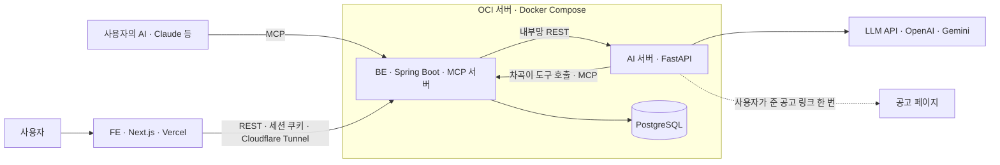
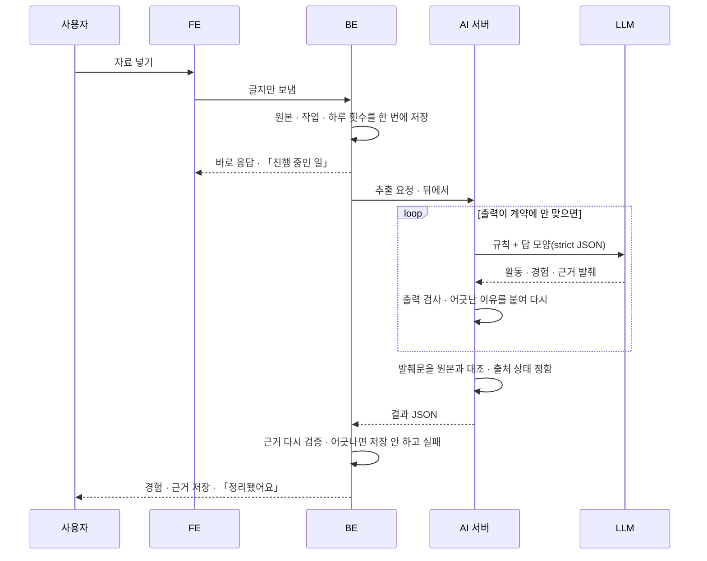

# 차곡

> 흩어진 기록은 차곡차곡 정리하고, 지원서엔 딱 맞게 꺼내 쓰는 AI 동료

2026 AI 우왕톤 12팀 「내가 우왕이 될 상인가」 — 서비스 이름은 **차곡**, 홈 입력 뒤에서 일하는 AI는 **차곡이**다.

우리 팀은 활동 · 프로젝트를 여럿 해 봤지만 지원할 때마다 그 경험을 다시 찾아 정리하는 학생 · 초기 경력자의 반복 부담을 줄이려고, AI 가 흩어진 자료에서 경험을 근거와 함께 찾아 쌓아 두고, 지원할 때 맞는 경험을 꺼내 부족한 사실만 묻는 서비스를 만들었다.

## 링크

| 무엇 | 주소 |
| --- | --- |
| 배포 | https://app-woowang.miroda.live |
| 심사위원 접속 방법 | 제출 전에 채움 |
| 테스트 계정 | 아이디 `test` · 비밀번호는 제출 폼에만 적는다(이 레포는 Public) |
| 시연 영상 | 제출 전에 채움 |
| 발표 자료 | 제출 전에 채움 |
| Notion | 제출 전에 채움 |

제출 전 확인 목록은 [`docs/hackathon.md`](docs/hackathon.md) 「마감 직전 체크」.

## 레포

| 레포 | 역할 | README |
| --- | --- | --- |
| [ETC](https://github.com/woowangthon/WOOWANGTHON_TEAM_12_ETC) (이 레포) | 명세 · API 계약 · 결정 기록(ADR) · 팀 공통 규칙 · 테스트 계정 견본 | — |
| [FE](https://github.com/woowangthon/WOOWANGTHON_TEAM_12_FE) | 화면(Next.js) | [FE README](https://github.com/woowangthon/WOOWANGTHON_TEAM_12_FE#readme) |
| [BE](https://github.com/woowangthon/WOOWANGTHON_TEAM_12_BE) | 인증 · 저장 · 분석 작업 · 하루 한도 · MCP 서버(Spring Boot) | [BE README](https://github.com/woowangthon/WOOWANGTHON_TEAM_12_BE#readme) |
| [AI](https://github.com/woowangthon/WOOWANGTHON_TEAM_12_AI) | LLM 호출 · 출력 검사 · 원문 대조(FastAPI) | [AI README](https://github.com/woowangthon/WOOWANGTHON_TEAM_12_AI#readme) |

## 문제와 대상

- **누가 · 언제**: 대학 시절 프로젝트 · 동아리 · 대외활동을 여럿 해 본 학생과 초기 경력자가 동아리 · 부트캠프 · 대외활동 · 인턴 · 채용 지원 문항 앞에 섰을 때.
- **무엇이 막히나**: 경험이 노션 · README · 회고 · 메모에 흩어져 있다. 지원할 때마다 그 경험을 다시 떠올리고, 문항마다 어떤 경험을 어떤 포인트로 쓸지 다시 정한다.
- **근거**: [`docs/SPEC.md`](docs/SPEC.md) §0. 팀원이 직접 겪은 지원 과정과 학교 경험분석 프로그램에서 본 것이 바탕이고, 설문의 표본과 한계는 발표 자료에 같이 적었다. 시간이 얼마나 줄어드는지는 재지 않았다.
- **이미 있는 것과 다른 점**: 자료 업로드 · 원문 근거 · 문항 매칭 · MCP 는 TIO · refresh.cv 같은 서비스에도 있다(공개 설명과 팀이 써 본 기록 기준). 그래서 기능 하나가 아니라 흐름으로 다름을 보인다.
  1. 초안 문장마다 어느 경험 · 근거에서 왔는지 보이고, AI 가 이어 붙인 문장은 따로 표시된다.
  2. 되묻기에 한 답 · 사용자가 확정한 답이 다시 경험으로 쌓여 다음 문항 · 다음 지원에서 다시 쓰인다.
  3. 쌓인 경험을 Claude 같은 내 AI 에서도 같은 규칙으로 꺼내 쓴다(MCP).

## AI 의 일 · 코드가 막는 일 · 사람이 정하는 일

AI 가 약한 곳(근거를 지어내기 · 없는 수치 붙이기 · 남의 일을 내 일로 쓰기)은 LLM 에 맡기지 않고 코드와 사람이 막는다. 기능별 전체 표는 [`docs/ai-scope.md`](docs/ai-scope.md) §2.

| 흐름 | AI(LLM)가 하는 일 | 코드가 막는 일 | 사람이 정하는 일 |
| --- | --- | --- | --- |
| 쌓기 — 추출 | 자료를 활동 · 경험으로 나누고 역량 · 수행 주체 · 분류를 붙인다 | 근거 발췌문이 원본에 실제로 있는지 대조한다. 출처 상태(원문에서 확인 · 내가 입력 · 확인 필요)는 LLM 이 아니라 코드가 정한다. 출력이 계약을 어기면 이유를 붙여 다시 부르거나 실패로 둔다 | 사실인지 · 내가 한 일인지 확인하고 고친다 |
| 꺼내기 — 매칭 · 되묻기 | 문항을 요구사항으로 쪼개 경험을 고르고, 문항에 필요한데 자료에 없는 사실을 묻는다 | AI 가 단 경험 · 근거 · 보완 ID 가 보낸 후보에 있는지, 같은 경험의 것인지, 되묻기가 문항당 3개 이하이고 추천한 경험에 붙었는지 | 어느 경험을 강조할지 고르고 되묻기에 답한다 |
| 쓰기 — 초안 · 근거 점검 | 문장을 쓰고 근거 · AI 보탬 · 빈칸 · AI 가정 · 생각으로 등급을 붙인다. 내가 쓴 글도 문장마다 점검한다 | 사실 문장의 근거 ID 와 문장 속 숫자가 받치는 글에 있는지 | 표시를 눌러 확인하고 고친다. 최종 문장은 사람이 정한다 |
| 공고 · 캡처 | 공고를 담당업무 · 자격 · 우대 · 기술스택 줄로 나누고 줄마다 받치는 경험을 판정한다. 캡처 속 글자를 읽는다 | 줄이 공고 글에 그대로 적혀 있는지 대조한다(요약 금지). 캡처는 대조할 원문이 없어 코드로 못 막는다 | 확인 단계에서 고친다. 캡처는 원본과 나란히 본다 |
| 차곡이 · MCP | 홈 입력을 가르고, 여러 단계가 필요하면 우리 도구를 불러 처리한다 | 도구 결과에 없는 숫자 · 이름을 거른다. 차곡이의 저장 · 변경은 확인 카드로 끝낸다. 외부 AI 가 고친 경험은 「확인 필요」로 낮추고 변경 기록을 남긴다 | 확인 카드를 누른다. 외부 AI 가 바꾼 것에 「맞아요」를 누르거나 되돌린다 |

**왜 AI 인가**: 자료가 회고 · README · 회의록 · 메모 · 자소서처럼 제각각이고, 한 줄에 내 일과 남의 일이 섞인다. 활동을 나누고, 누가 했는지 읽고, 문항이 묻는 능력과 경험 본문을 맞추는 일은 형식 규칙 · 키워드 · 태그로는 되지 않는다. 그래서 매칭도 태그가 아니라 경험 본문으로 판정한다.

## 사용 흐름

1. **쌓기** — 글 · 파일(md · txt · PDF · PPTX) · 옵시디언 폴더 · Notion ZIP · 공개 GitHub 레포를 넣는다. 넣기 전에 「외부 AI 로 보내져 분석된다」가 보인다.
2. AI 가 활동과 여러 관점의 경험을 뽑고 **원문 근거**를 단다. 연도별 타임라인과 활동 세부에서 본다.
3. **꺼내기** — 지원 문항 또는 공고(글 · 링크 · 캡처)를 넣으면 맞는 경험을 추천한다. 요구사항별로 「근거 있음 / 일부 / 자료에서 확인 안 됨」이 보인다.
4. 부족한 사실을 문항당 최대 3개까지 **되묻는다**. 없는 수치를 지어내지 않는다.
5. 짧게 답하면 그 경험의 **보완**으로 쌓인다.
6. 다른 문항에서 같은 활동의 다른 관점과 방금 쌓은 답이 **다시 쓰이고**, 같은 것을 다시 묻지 않는다.
7. **쓰기** — 구성 틀을 골라 초안을 만든다. 문장을 누르면 근거 원문이 보이고, 확정한 답에서 새로 쓴 사실은 「새 경험 후보」로 돌아온다.
8. Claude 같은 **내 AI 에서 MCP 로** 같은 경험을 검색한다. 쓰기를 켠 연결이면 자료 넣기 · 경험 고치기 · 지원 만들기 · 되묻기 답도 된다.

화면 목록과 동작 하나하나의 명세는 [`docs/SPEC.md`](docs/SPEC.md).

## 구현 범위와 한계

- **코드에 있는 것**: 위 흐름 전체와 로그인 · 하루 분석 한도 · 수정 이력 · Markdown 내보내기 · 공개 프로필. 명세의 P0 는 전부 코드에 있고 P1 도 거의 다 있다.
- **일부만 된 것**
  - 가져오기는 Notion 내보내기 ZIP 과 공개 GitHub 레포를 **한 번** 읽는 방식이다. 계정 연동 · 다시 가져오기는 하지 않았다.
  - MCP 는 연결 주소 방식이고 Claude Code 로 쌓기 · 꺼내기까지 확인했다. OAuth · 클라이언트별 연결은 없다.
  - 초안은 외부 AI 에서 만들 도구가 없다. 구성 틀 · 문장 등급 · 근거 ID 검사는 웹에서만 돈다.
- **만들지 않은 것**: 기업 분석 리포트 · 합격 예측 점수 · 채팅창이 본체인 AI · 모의 면접.
- **재지 않은 것**: 시간 절감 · 정확도 향상. 설문은 불편과 사용 의향까지만 물었다.
- 검증의 한계는 아래 「AI 활용과 검증」과 [`docs/ai-scope.md`](docs/ai-scope.md) §5.

## 아키텍처



| 구성 | 스택 | 하는 일 | 맡기지 않은 것 |
| --- | --- | --- | --- |
| FE | Next.js 16 · React 19 · TypeScript · Tailwind CSS 4 · Vercel | 화면, 그 자리 고치기, 브라우저에서 파일 글자 뽑기(PDF · PPTX · Notion ZIP · GitHub) | 데이터 판단 — 전부 BE API 로 |
| BE | Spring Boot · JPA · Flyway · PostgreSQL | 인증 · 저장 · 사용자 구분 · 하루 한도 · 분석 작업 · AI 결과를 보낸 후보와 맞추기 · MCP 서버. **AI 서버를 부르는 유일한 곳** | LLM 호출 |
| AI | Python · FastAPI | LLM 호출 · 출력 계약 검사 · 원문 · 숫자 대조 · 차곡이 도구 루프. DB 가 없고 받은 JSON 만 보고 JSON 만 돌려준다 | 저장 · 사용자 상태 |
| MCP | BE 안 · `POST /mcp/{token}` | 도구 8개 — 기본은 읽기 3개, 연결에서 쓰기를 켜면 5개 더. 도구는 이 한 곳에만 정의하고 차곡이도 같은 도구를 쓴다 | — |
| 배포 | OCI 서버 한 대 · Docker Compose · Cloudflare Tunnel | 밖에는 BE 만 내고 AI 서버 · DB 는 내부망. LLM 키는 AI 서버에만 둔다 | — |

### 쌓기 흐름 — 입력 → 처리 → 출력



- 사용자는 기다리지 않고 다른 화면을 쓴다. 새로고침해도 이어지고, 서버가 다시 켜지면 멈춘 일을 정리한다.
- 일이 안 되면 그 일만 「실패 · 다시 시도」가 되고 정해진 결과로 채우지 않는다. 다른 흐름과 쌓인 기록은 그대로다.
- 하루 한도는 일을 시작하는 묶음 안에서 센다. 동시에 눌러도 한도를 넘지 않는다.
- 계약 · 엔드포인트는 [`docs/contracts/`](docs/contracts/), 구조 설명은 [`docs/architecture.md`](docs/architecture.md).

## 기술 선택과 이유

되돌리기 비싼 결정만 [`docs/decisions/`](docs/decisions/)에 ADR 로 남겼다. 핵심만 줄여 옮긴다.

| 정한 것 | 이유 | 버린 안 | 기록 |
| --- | --- | --- | --- |
| BE(Spring Boot)와 AI 서버(FastAPI)를 나누고, AI 서버는 DB 없이 JSON 만 주고받는다 | 계약 하나로 병렬 개발한다. 저장 · 사용자 구분 · 호출 횟수는 BE 가, LLM 은 AI 서버가 맡아 서로 상태를 몰라도 되고 시험 · 재시작이 쉽다 | BE 하나에서 LLM 까지(담당이 같은 코드에서 부딪친다) · AI 서버가 DB 직접 읽고 쓰기(스키마를 두 레포가 알아야 한다) | [ADR-003](docs/decisions/ADR-003-stack-and-ai-boundary.md) |
| 임베딩 검색 · 에이전트 프레임워크 없이, 경험 전부를 본문째 LLM 에 넘겨 판정한다 | 한 사람의 경험은 수십 ~ 백여 개라 후보를 줄일 필요가 없고 본문 판정이 단순하고 정확하다. DB 이미지는 pgvector 로 받아 두어, 경험이 수백 개가 되면 확장만 켠다 | 처음부터 pgvector · LangGraph(지금 크기에선 설정 · 디버깅 비용만) | [ADR-003](docs/decisions/ADR-003-stack-and-ai-boundary.md) |
| 서버 한 대에 Docker Compose, Cloudflare Tunnel 로 BE 만 내보낸다 | 팀 크기 · 일정에 맞는 가장 단순한 운영. AI 서버 · DB 는 밖에 열지 않는다 | PaaS 서비스별 배포(서비스가 셋이라 무료 한도 · 잠자기에 걸림) · 포트 직접 공개 | [ADR-004](docs/decisions/ADR-004-deploy.md) |
| FE 는 Next.js + Vercel, main 만 운영으로 자동 배포 | 데이터 · 인증 · AI 호출은 전부 BE API 로 두고 FE 는 화면만 맡는다. PR 미리보기는 하루 배포 한도에 걸려 껐고 UI PR 은 스크린샷을 붙인다 | Vite + Cloudflare Pages · Compose 에 FE 함께 | [ADR-005](docs/decisions/ADR-005-fe-stack.md) · [ADR-020](docs/decisions/ADR-020-no-pr-preview.md) |
| 차곡이: 가르기는 LLM 한 번 + 분기, 여러 단계가 필요할 때만 도구 루프 | 가벼운 입력은 빠르게 하고 긴 일만 루프로 보낸다. 채팅창이 아니라 경험이 본체다 | 처음부터 도구 에이전트 · 화면마다 버튼만 · 채팅창을 화면 본체로 | [ADR-007](docs/decisions/ADR-007-chagok-entrance-agent.md) |
| MCP 서버와 도구는 BE 한 곳에 두고 차곡이는 그 클라이언트로 쓴다 | 토큰 · 사용자 · 한도가 BE 에 있다. 도구 하나가 코드 한 곳이라 안팎이 어긋나지 않는다 | AI 레포에 파이썬 MCP 서버(내부 서버를 밖에 열어야 함) · 도구를 두 벌 정의 | [ADR-008](docs/decisions/ADR-008-mcp-tools-in-be.md) |
| 외부 AI 의 쓰기는 바로 반영하고, 고친 경험은 「확인 필요」로 낮추고, 변경 기록에서 되돌린다 | 대화를 끊지 않는다. 사용자가 웹에서 「맞아요」를 누르기 전엔 근거로 쓰지 않는다. 강제는 안내 글이 아니라 BE 코드가 한다 | 앱 안 확인 대기함 · 외부 AI 의 도구 승인에만 맡기기 | [ADR-010](docs/decisions/ADR-010-external-ai-write.md) · [ADR-011](docs/decisions/ADR-011-external-ai-features.md) |
| 초안 문장을 종류로 구분해 쓰고, 자료에 없는 장면은 「AI 가정」으로 표시한다 | 분량을 채우면서 무엇이 사실인지 보인다 | 근거 없으면 안 쓰기(분량 부족) · 표시 없이 자연스럽게 채우기(범용 LLM 과 같아지고 지어낸 장면이 사실처럼 제출됨) | [ADR-012](docs/decisions/ADR-012-draft-sentence-tiers.md) · [ADR-014](docs/decisions/ADR-014-draft-supposed-sentences.md) · [ADR-015](docs/decisions/ADR-015-supposed-review-family.md) |
| 공고는 요건 줄만 원문 그대로 저장한다 | 공고가 매칭의 맥락이 되고, AI 해석이 원문처럼 보이지 않는다 | 공고 요약 저장 · 문항 칸 아래에 붙여 문항 글로 보내기 | [ADR-016](docs/decisions/ADR-016-posting-lines-and-capture.md) |
| STAR 는 채우지 않고 빈칸을 보이고 묻는다 | 원본에 없는 말을 만들지 않는다. 빈칸이 다음 지원의 재료를 모으는 질문이 된다 | AI 가 STAR 를 다 채우기 · 활동별 STAR | [ADR-017](docs/decisions/ADR-017-star-gaps-not-filled.md) · [ADR-019](docs/decisions/ADR-019-star-no-auto-resort.md) |
| 구분은 데이터에 저장하고 화면엔 예외(AI 해석 · AI 가정 · 확인 필요)만 보인다 | 구분은 데이터가 지키고 화면은 할 일만 보인다 | 모든 경험에 출처 상태를 늘 글자로 · 구분 없애기 | [ADR-018](docs/decisions/ADR-018-show-only-exceptions.md) |
| 경험 · 활동 · 답은 고칠 때마다 이전 값을 남긴다 | 사용자가 고친 것 · 외부 AI 가 바꾼 것을 건별로 되돌린다 | 변경 기록 한 화면에 모으기 · 자동 저장까지 모두 기록 | [ADR-013](docs/decisions/ADR-013-revision-history.md) |

## 직접 구현 vs 외부 기술

표 전체와 출처는 [`docs/ai-scope.md`](docs/ai-scope.md) §1 · §4.

| 직접 구현 | 가져다 쓴 것 |
| --- | --- |
| AI 흐름 전부의 프롬프트 · 출력 계약 · 다시 부르기 · 모델 이어 받기 | LLM — OpenAI 유료 API(기본) · Gemini(선택, 키가 있을 때만). 나누고 고르고 쓰는 것은 LLM 이 한다 |
| 근거 · STAR 칸 · 공고 줄 · 숫자를 원문과 잇는 코드(LLM 안 씀) | FastAPI · Pydantic · openai SDK · google-genai SDK · MCP Python SDK · jsonschema · requests · Beautiful Soup |
| 차곡이 도구 루프 · 확인 카드 | MCP 명세 · Claude(클라이언트) |
| MCP 서버(라이브러리 없이 다섯 메서드를 받는 컨트롤러) · 연결 토큰 · 쓰기 범위 · 변경 기록 · 되돌리기 | Spring Boot · JPA · Flyway · BCrypt · PostgreSQL |
| 저장 · 출처 상태 규칙 · 분석 작업 · 차례 · 재시작 정리 · 하루 한도 · 로그인 흐름 | pdf.js · JSZip · GitHub 공개 REST API(브라우저에서 글자 뽑기) |
| 브라우저 파일 글자 뽑기의 쪽 · 슬라이드 · 줄 맞추기 | Next.js · React · Tailwind CSS · shadcn/ui · Radix UI |
| 채점 스크립트 · 시험 자료 · 정답 | Docker · Docker Compose · OCI · Cloudflare Tunnel · Vercel |

## AI 활용과 검증

기능마다 **지어낸 시험 자료 + 손으로 적은 정답 + 채점 스크립트**로 재고, 같은 모델에 「이 자료에서 내 경험을 정리해 줘」 같은 범용 프롬프트만 준 결과와 나란히 봤다. 쓴 모델은 `gpt-6.1-terra` → `gpt-6-luna` → `gpt-5.4-mini` 순으로 넘어간다(키가 있으면 Gemini Flash 까지). 첫 모델은 채점으로 골랐다. 방법 · 전체 숫자의 원본은 [`docs/ai-scope.md`](docs/ai-scope.md) §2, 다시 돌리는 법은 [AI 레포 README](https://github.com/woowangthon/WOOWANGTHON_TEAM_12_AI#readme)의 `scripts/eval_*.py`.

| 무엇을 쟀나 | 범용 프롬프트만 | 차곡 | 조건 |
| --- | --- | --- | --- |
| 자료에서 찾은 경험(정답 47개) | 36 | 44 · 45 (두 번 실행) | `gpt-6.1-terra`, 지어낸 자료 9건, 2026-11-03 |
| 문항에 다른 경험의 근거 ID 를 붙인 횟수 | 20문항 중 3번 | 49문항 중 0번 | 지어낸 경험 20개 · 문항 10개. 범용은 코드가 걸러 다시 부른 뒤에도 같아 오류로 끝났다 |
| 초안에 지어낸 근거 ID | 22건 | 0건 | `gpt-6.1-terra`, 31쌍(문항 · 고른 경험), 2026-11-08 |
| 초안의 생각 문장에 근거를 붙인 위반 | 20건 | 0건 | 같음 |
| 자료에 없는 사실에 확인 질문이 붙은 수(17개 중) | 4 | 16 | 같음 |

- 원문에 없는 수치는 추출 · 매칭에서 우리 쪽 0건이었다.
- **차이로 말하지 않는 것**: 근거 발췌문이 원본과 일치한 비율은 범용도 60/60 이었다(범용 출력에도 인용 칸이 있어서). 홈 입력 가르기도 기본 모델에서는 범용도 40/40 이었고 작은 모델(`gpt-5.4-mini`)에서만 차이가 났다.
- **한계**
  - 시험 자료는 **지어낸 한 사람**의 것이라 실제 자료보다 쉽다. 정답은 AI 에이전트가 초안을 쓰고 팀원 검토 전이다.
  - 근거 대조는 발췌문 **글**이 원본에 있는지만 본다. 남의 일이 섞인 줄도 「원문에서 확인」이 될 수 있고, 해석이 맞는지는 사람이 본다.
  - 캡처 읽기는 대조할 원문이 없어 글자가 바뀌었는지 코드로 확인하지 못한다. 사용자가 캡처와 나란히 본다.
  - 초안의 목표 글자 수는 노릴 뿐 맞추지 않는다. 재료가 모자라면 지어내지 않고 짧게 끝난다(채점에서 목표의 5 ~ 59%).
  - 경험 전부를 한 번에 넘기므로 경험이 수백 개가 되면 느려진다. 그때 임베딩으로 후보를 줄인다.
  - 이 밖의 알려진 한계는 [`docs/ai-scope.md`](docs/ai-scope.md) §5.

## 목 · 샘플 · 테스트 계정

- 코드의 `MOCK(<id>)` · `SAMPLE(<id>)` 마커는 [`docs/ai-scope.md`](docs/ai-scope.md) §3 표와 1:1 이다. `rg -n "(MOCK|SAMPLE)\("`(네 레포).
- FE 의 목 모드는 API 주소를 비운 로컬 · 개발용에서만 돈다. 배포 화면은 실제 BE · AI 를 부른다.
- AI 레포의 `samples/` 는 채점용 지어낸 자료다. 제품 동작에는 쓰이지 않는다.
- 테스트 계정 `test` 에는 지어낸 인물(컴퓨터공학 4학년 · 백엔드 지망)의 자료로 만든 견본을 넣는다. 자료는 견본이고 그 위의 추출 · 추천 · 초안은 실제 AI 분석이다. 자료 이름은 `견본-…`, 지원처는 `(견본)` 으로 표시한다([`demo/test-account/`](demo/test-account/)).

## 실행 방법

로컬에서 전체를 띄우는 순서다. 레포마다 자세한 방법은 각 README.

```bash
# 1. DB — BE 레포
docker compose -f compose-local.yaml up -d

# 2. AI 서버 — AI 레포 (OPENAI_API_KEY 필요, Gemini 는 선택)
uv sync && cp .env.example .env     # .env 에 키를 넣는다
uv run uvicorn app.main:app --env-file .env --port 8000

# 3. BE — BE 레포 (JDK 25 · Docker)
./gradlew bootRun                   # http://localhost:8080 · AI_BASE_URL 기본값이 localhost:8000

# 4. FE — FE 레포 (Node.js 20.9 이상)
npm install
NEXT_PUBLIC_API_BASE_URL=http://localhost:8080/api npm run dev   # http://localhost:3000
```

- AI 서버가 없으면 분석 작업은 `FAILED` 가 된다. 정해진 결과로 대신 채우지 않는다.
- 예시 데이터로 화면을 채우려면 BE 를 `SEED_SAMPLE=true TEST_ACCOUNT_PASSWORD=<임의 값>` 으로 켠다. 공개 전에는 끈다.
- 서버에 띄우는 법(Compose · Cloudflare Tunnel)은 BE README 「서버에 띄우기」.

## 개발 방식

[ADR-001](docs/decisions/ADR-001-workflow.md) · [ADR-002](docs/decisions/ADR-002-sprints.md) · [ADR-006](docs/decisions/ADR-006-spec-contract-notify.md). 규칙 전문은 [`AGENTS.md`](AGENTS.md)(사람도 같은 규칙을 따른다).

- **명세는 문서로**: 개발 명세는 [`docs/SPEC.md`](docs/SPEC.md) 하나, FE · BE · AI 사이 약속은 [`docs/contracts/`](docs/contracts/), 되돌리기 비싼 결정은 ADR. 정한 것은 이슈 댓글이나 SPEC 으로 옮겨 코드와 문서가 어긋나지 않게 한다.
- **할 일의 원본은 GitHub Issue**: 스프린트는 사용자 흐름 하나씩이다. 흐름 하나를 화면부터 DB · AI 까지 먼저 이은 뒤 써 보며 고친다.
- **AI 에이전트와 함께 개발**: 이슈 → 브랜치 → 구현 → 검증 → PR 의 단계를 에이전트 스킬로 정해 두고(`implement-issue` · `next-up` · `plan-feature` · `sync-spec`), 사람은 이슈 선정 · 결정 · 리뷰 · 머지를 맡는다. 스킬 · 공통 규칙은 이 레포에서 고치고 `scripts/sync-shared.sh` 로 각 레포에 맞춘다.
- **PR 규칙**: main 에 직접 push 하지 않는다. 계약 · SPEC 을 바꾸는 PR 은 영향받는 이슈에 알린다. FE 는 CI(lint · 타입 검사 · 빌드)와 Playwright 시험, UI PR 은 1440 · 1024 · 390 스크린샷으로 확인한다.
- **새 팀원용 시작**: 네 레포를 한 폴더에 클론한다.

  ```bash
  mkdir woowangthon-12 && cd woowangthon-12
  for r in ETC FE BE AI; do gh repo clone woowangthon/WOOWANGTHON_TEAM_12_$r; done
  ```

## 팀

| 이름 | 역할 |
| --- | --- |
| 정성오 | PM · 풀스택 · 기획 — 서비스 기획 · 명세 · API 계약 설계, AI 서버 · 백엔드 · 프론트엔드 전반의 핵심 기능 구현 |
| 변진호 | 프론트엔드 — 연도별 타임라인 · 자료 업로드 · 인증 · 지원서 공고 매칭 등 주요 화면 구현 |
| 염수빈 | 디자인 — UI/UX 디자인 시스템 정립, 서랍 · 타임라인 · 문항 화면 디자인 · 프론트엔드 구현 |
| 전세원 | 프론트엔드 — 경험 편집 · 답변 초안 · MCP 연결 · 폴더 · Notion · GitHub 가져오기 등 기능과 API 연동 |
| 최상영 | 백엔드 · 집중 QA · 인프라 / 배포 — 백엔드 핵심 API와 답변 초안 · 근거 점검 기능 구현, 서버 인프라 · 배포 운영 · 집중 QA |

## 문서

| 문서 | 내용 |
| --- | --- |
| [`docs/SPEC.md`](docs/SPEC.md) | 개발 명세 — 무엇을 어떻게 동작하게 만드나 |
| [`docs/architecture.md`](docs/architecture.md) | 아키텍처 |
| [`docs/contracts/`](docs/contracts/) | FE · BE · AI 사이 API · JSON 계약 |
| [`docs/decisions/`](docs/decisions/) | 기술 선택의 이유(ADR) |
| [`docs/ai-scope.md`](docs/ai-scope.md) | 직접 구현 vs 외부 기술 · AI 기능과 검증 · 목 · 샘플 · 출처 · 한계 |
| [`docs/design/DESIGN.md`](docs/design/DESIGN.md) | 화면 · 디자인 기준 |
| [`docs/hackathon.md`](docs/hackathon.md) | 대회 규칙 · 일정 · 제출물 · 배점 (팀 내부용) |
