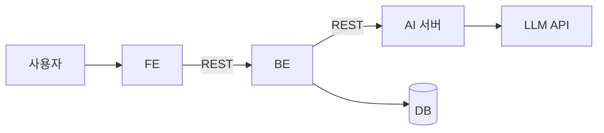

# 아키텍처

> 스택이 정해지면 채운다. 다이어그램은 GitHub 이 그려 주는 mermaid 로.

## 구성 요소

| 구성 | 레포 | 스택 | 하는 일 |
| --- | --- | --- | --- |
| FE | `WOOWANGTHON_TEAM_12_FE` | 미정 | |
| BE | `WOOWANGTHON_TEAM_12_BE` | 미정 | |
| AI | `WOOWANGTHON_TEAM_12_AI` | 미정 | |

## 배포

미정.
